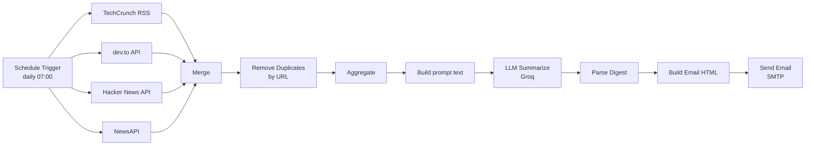

# Tech News Digest (n8n workflow)

An [n8n](https://n8n.io) workflow that emails you a curated tech news digest every morning. It pulls headlines from four sources, asks an LLM to pick the best ones per topic and summarise them, and sends the result as an HTML email.

The whole workflow is one file: [`Tech News digest.json`](Tech%20News%20digest.json).

## How it works

1. **Trigger**: runs once a day at 07:00, in the timezone of the n8n instance.
2. **Fetch**: four sources are queried in parallel.

   | Source | Endpoint | Auth |
   | --- | --- | --- |
   | TechCrunch | `https://techcrunch.com/feed/` (RSS) | none |
   | dev.to | `https://dev.to/api/articles?tag=ai&top=1` (top `ai`-tagged posts of the last day) | none |
   | Hacker News | `https://hn.algolia.com/api/v1/search?tags=front_page` | none |
   | NewsAPI | `https://newsapi.org/v2/everything`, query `AI OR cloud OR cybersecurity OR software`, English, newest 20 | API key |

3. **Normalise**: each source is mapped to the same four fields: `source`, `title`, `url`, `published_at`. Hacker News posts without an external link fall back to their HN discussion URL.
4. **Merge and dedupe**: the four lists are appended into one and duplicates are dropped by `url`.
5. **Summarise**: the list is flattened to one line per article (`[source] title (url)`) and sent to Groq's OpenAI-compatible chat completions API using the `openai/gpt-oss-120b` model. The prompt asks for the 4-5 best items per topic (max 20 total) across **AI/ML**, **Software Engineering**, **Cloud/DevOps** and **Cybersecurity**, each with a 1-2 sentence summary, returned as a JSON array of `{topic, title, url, summary}`.
6. **Email**: the JSON is parsed, grouped by topic into simple HTML, and sent over SMTP with the subject `Your Daily Tech Digest — YYYY-MM-DD`.

## Setup

### Prerequisites

- An n8n instance (self-hosted or n8n Cloud)
- A [NewsAPI](https://newsapi.org) key (the free tier is enough)
- A [Groq](https://console.groq.com) API key
- An SMTP account. For Gmail, use an [app password](https://support.google.com/accounts/answer/185833)

### Install

1. In n8n, create a new workflow and choose **Import from File**, then select `Tech News digest.json`.
2. Create the two credentials the workflow references and attach them to their nodes:

   | Node | Credential type | Values |
   | --- | --- | --- |
   | **LLM Summarize** | Header Auth | Name: `Authorization`, Value: `Bearer <your Groq API key>` |
   | **Send an Email** | SMTP | For Gmail: host `smtp.gmail.com`, port `465`, SSL on, your address and app password |

3. Open the **NewsApi** node and set the `apiKey` query parameter to your own key.
4. Open the **Send an Email** node and set **From Email** and **To Email** to your own addresses.
5. Run the workflow once manually to check the email arrives, then activate it.

## Customising

| To change | Edit |
| --- | --- |
| Send time or frequency | **Schedule Trigger** |
| NewsAPI search terms or article count | the `q` and `pageSize` values in the **NewsApi** URL |
| dev.to tag | the `tag` value in the **dev.to** URL |
| Topics, number of picks, summary style | the prompt in **LLM Summarize** |
| Model or provider | `model` and the URL in **LLM Summarize** (any OpenAI-compatible endpoint works) |
| Email layout | the expression in **Build Email HTML** |
| Recipients, subject | **Send an Email** |

To add a source, add a fetch node plus a Set node that outputs the same four fields (`source`, `title`, `url`, `published_at`), increase the input count on **Merge**, and connect it.

## Known limitations

- **No error handling.** If any source request fails, the run fails and no email is sent.
- **Strict JSON parsing.** **Parse Digest** calls `JSON.parse` on the raw model reply, so the run fails if the model wraps its answer in Markdown fences or adds commentary.
- **Deduplication is exact-match on URL.** The same story from two outlets, or the same URL with different tracking parameters, is not caught. The Hacker News URL expression also has a trailing space, so HN items never match the same link from another source.
- **No memory between runs.** A story that stays on a front page for two days can appear in two digests.
- **`published_at` is collected but unused.** Items are not filtered or sorted by age.
- **Unescaped HTML.** Titles and summaries are inserted into the email as-is.
